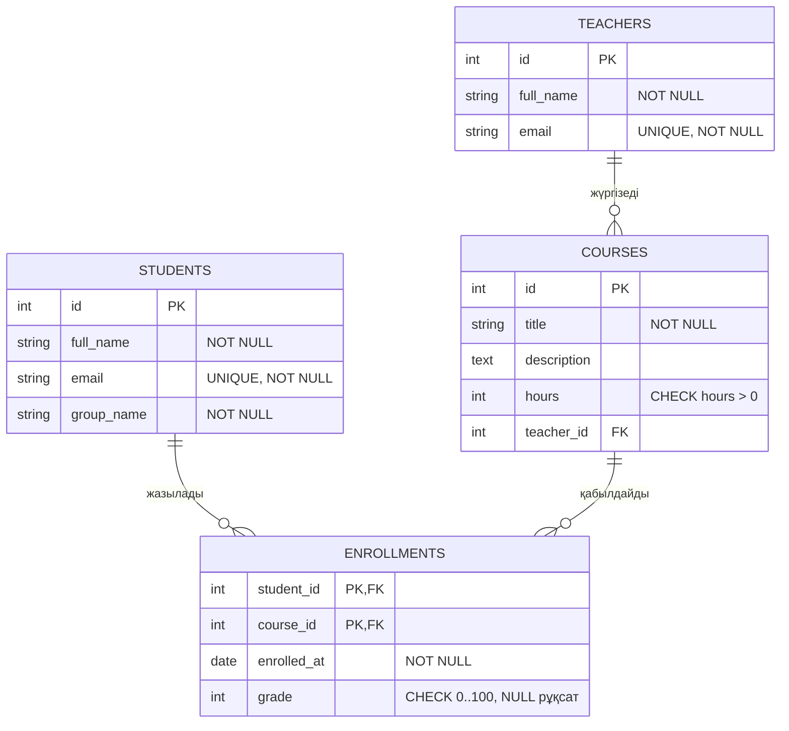

# Оқу орталығы: PostgreSQL, Sequelize, REST API

Зертханалық жұмыс: дерекқор схемасын жобалау, SQL, бұлттағы PostgreSQL (Neon), ORM (Sequelize) және Node.js-те REST API.

## Іске қосу

```bash
npm i
cp .env.example .env        # DATABASE_URL ішіне Neon қосылу жолын қойыңыз
# Neon SQL Editor-да ретімен орындаңыз: sql/schema.sql, sql/seed.sql
node src/test.js            # ORM тексеру скрипті
node src/server.js          # API: http://localhost:3000/courses
```

`.env` файлы `.gitignore` ішінде, репозиторийге түспейді.

## 1. ER-диаграмма



Байланыстар:

- **Оқытушы - Курс: бірден көпке.** `courses.teacher_id` сыртқы кілті, `NOT NULL` (әр курстың міндетті түрде бір оқытушысы бар).
- **Студент - Курс: көптен көпке** `enrollments` байланыстырушы кестесі арқылы. Құрама бастапқы кілт `(student_id, course_id)` студенттің бір курсқа екі рет жазылуына жол бермейді.

Шектеулер: `PRIMARY KEY` (барлық кестеде), `FOREIGN KEY` (`courses.teacher_id`, `enrollments.student_id`, `enrollments.course_id`), `NOT NULL`, `UNIQUE` (`email` оқытушы мен студентте), `CHECK` (`hours > 0`, `grade BETWEEN 0 AND 100`). `grade` өрісі баға қойылғанға дейін `NULL` болады.

## 2. Неліктен схема 3ҚФ-те

Барлық өрістер атомарлы (1ҚФ): мысалы, студенттің аты-жөні, email және тобы бөлек бағандарда, тізім түрінде сақталмайды. Байланыстырушы кестедегі құрама кілттің `(student_id, course_id)` бөлігінен ғана тәуелді атрибут жоқ: `enrolled_at` пен `grade` екі өріске бірдей тәуелді, сондықтан ішінара тәуелділік (2ҚФ бұзылуы) жоқ. Оқытушының аты-жөні мен email-ы курстар кестесінде қайталанбайды, тек `teacher_id` сақталады, яғни кілтті емес атрибут басқа кілтті емес атрибутты анықтамайды (транзитивті тәуелділік жоқ, 3ҚФ). Сондықтан деректі өзгерту (мысалы, оқытушының email-ы) бір жерде ғана жасалады және аномалиялар болмайды.

## 3. Файлдар

| Файл | Мазмұны |
| --- | --- |
| `sql/schema.sql` | `DROP TABLE IF EXISTS ... CASCADE` және `CREATE TABLE` |
| `sql/seed.sql` | Әр кестеде 4-5 жазба |
| `sql/queries.sql` | SELECT, JOIN, LEFT JOIN, GROUP BY/HAVING, ішкі сұраным, UPDATE/DELETE, транзакция, бонус (индекс + EXPLAIN ANALYZE) |
| `src/db.js` | Sequelize қосылымы, модельдер, байланыстар |
| `src/test.js` | ORM тексеру скрипті |
| `src/server.js` | REST API |

## 4. Бонус: индекс және EXPLAIN ANALYZE

`enrollments` кестесінде ~50 000 жол болғанда `WHERE course_id = 3` сұранысы. PK индексі `student_id` бағанынан басталады, сондықтан `course_id` бойынша іздеуге көмектеспейді.

| | Жоспар | Орындалу уақыты |
| --- | --- | --- |
| Индекске дейін | `Seq Scan on enrollments` | ≈ 3.2 мс |
| `CREATE INDEX idx_enrollments_course_id` кейін | `Bitmap Index Scan` + `Bitmap Heap Scan` | ≈ 1.6 мс |

Нақты сандар құрылғы мен Neon-ға байланысты өзгеруі мүмкін, бірақ жоспардың ауысуы (Seq Scan → Index Scan) сақталады.

## 5. REST API

| Әдіс | Жол | Сипаттама | Сәтті жауап | Қателер |
| --- | --- | --- | --- | --- |
| GET | `/courses` | Барлық курс оқытушысымен | 200 | |
| GET | `/courses/:id` | Бір курс | 200 | 400, 404 |
| POST | `/courses` | Курс қосу | 201 | 400, 404 (оқытушы жоқ) |
| PUT | `/courses/:id` | Курсты өзгерту | 200 | 400, 404 |
| DELETE | `/courses/:id` | Курсты жою (жазылулар да өшеді) | 200 | 400, 404 |
| POST | `/enrollments` | Студентті курсқа жазу | 201 | 400, 404, 409 (қайталанған жазылу) |
| GET | `/students/:id/courses` | Студенттің курстары бағасымен | 200 | 400, 404 |

Кодтар: **200** сәтті, **201** жасалды, **400** кіріс деректері қате, **404** табылмады, **409** қайшылық (қайталану).

### curl мысалдары (нақты жауаптар)

```bash
curl http://localhost:3000/courses/1
# 200
# {"id":1,"title":"SQL негіздері","description":"Реляциялық дерекқорлар және SQL тілі","hours":40,"teacherId":1,"Teacher":{"id":1,"fullName":"Серіков Асхат Бауыржанұлы","email":"a.serikov@center.kz"}}

curl -X POST http://localhost:3000/courses -H 'Content-Type: application/json' \
  -d '{"title":"Docker","description":"Контейнерлер","hours":20,"teacherId":3}'
# 201
# {"id":6,"title":"Docker","description":"Контейнерлер","hours":20,"teacherId":3}

curl -X POST http://localhost:3000/courses -H 'Content-Type: application/json' -d '{"title":"","hours":-5}'
# 400
# {"errors":["title: бос емес жол болуы керек","hours: 0-ден үлкен бүтін сан болуы керек","teacherId: оң бүтін сан болуы керек"]}

curl -X POST http://localhost:3000/courses -H 'Content-Type: application/json' -d '{"title":"X","hours":5,"teacherId":99}'
# 404
# {"error":"Оқытушы табылмады"}

curl -X PUT http://localhost:3000/courses/6 -H 'Content-Type: application/json' -d '{"hours":32}'
# 200
# {"id":6,"title":"Docker","description":"Контейнерлер","hours":32,"teacherId":3}

curl -X POST http://localhost:3000/enrollments -H 'Content-Type: application/json' -d '{"studentId":1,"courseId":6}'
# 201
# {"enrolledAt":"2026-11-12","studentId":1,"courseId":6,"grade":null}

curl -X POST http://localhost:3000/enrollments -H 'Content-Type: application/json' -d '{"studentId":1,"courseId":6}'
# 409
# {"error":"Студент бұл курсқа бұрыннан жазылған"}

curl -X POST http://localhost:3000/enrollments -H 'Content-Type: application/json' -d '{"studentId":1,"courseId":6,"grade":150}'
# 400
# {"errors":["grade: 0-ден 100-ге дейінгі бүтін сан болуы керек"]}

curl http://localhost:3000/students/1/courses
# 200 (студент және оның курстары: Enrollment ішінде баға, Teacher ішінде оқытушы)

curl -X DELETE http://localhost:3000/courses/6
# 200
# {"message":"Курс жойылды","id":6}

curl -X DELETE http://localhost:3000/courses/6
# 404
# {"error":"Курс табылмады"}
```
